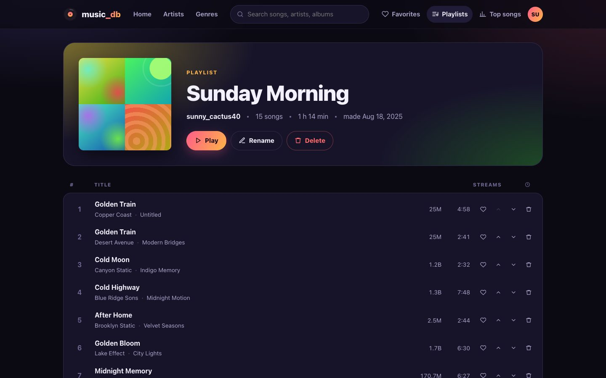
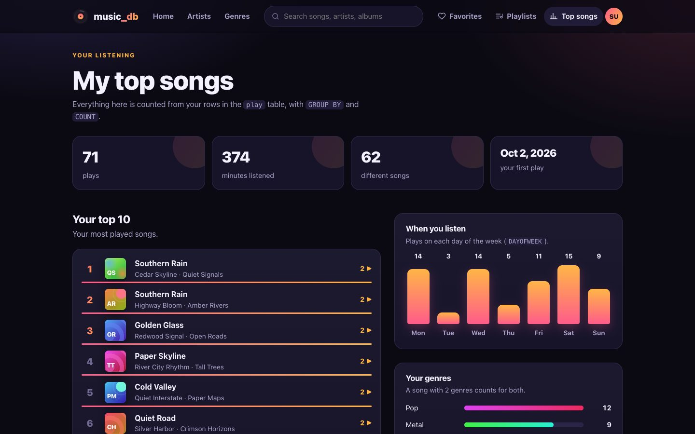
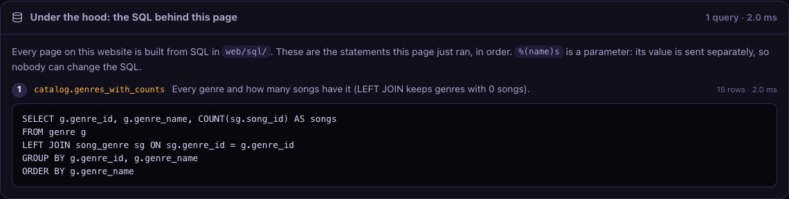
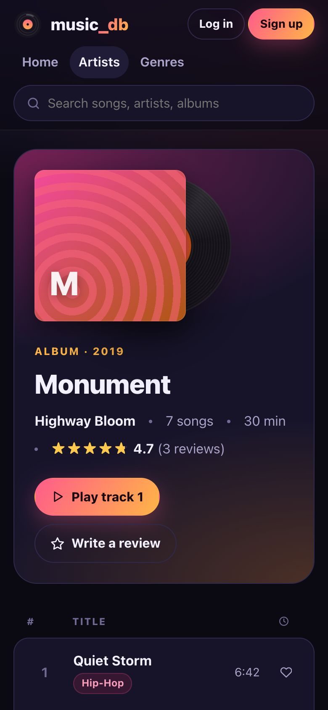

# music_db

A small music website where listeners browse artists, albums and songs, ♥ the songs they
love, build playlists in their own order, and review albums with 1 to 5 stars.

It has two parts: a **MySQL database** with 11 tables, built in 4 stages with migrations,
and a **real website** made with Python and Flask that uses it.

My final project for CS330 (Databases) at Olympic College.


- **The database design:** [docs/design.md](docs/design.md) (tables, keys, relationships,
  and the 4 stages)
- **The website:** [docs/app.md](docs/app.md) (every page, the SQL it runs, and how it is
  kept safe)

## What the website can do

| For everyone | For logged-in listeners | For the admin |
|---|---|---|
| Browse artists, albums and genres | ♥ songs, and see "My favorites" | Add artists, albums and songs |
| Search songs, artists and albums | Make playlists, put songs in order | Set a song's genres |
| See the most played songs and the best rated albums | Press ▶ (saves a play) and see "My top songs" | |
| Read album reviews | Write, change or delete a review | |

Every page shows its own SQL: open **"Under the hood"** at the bottom of any page to see
the statements that built it.

There is no real sound. Pressing ▶ saves one row in the `play` table.

## Run it on your computer

You need **MySQL 8 or 9** and **Python 3.10 or newer**. Run every command from this folder.

**1. Build the database.** This deletes the old `music_db` database, then builds it stage
by stage, with the practice data:

```sh
mysql --local-infile=1 --commands -u root -p < scripts/build.sql
```

If MySQL says "Loading local data is disabled", run `SET GLOBAL local_infile = 1;` once as
root.

**2. Make a MySQL user for the website.** It can read and change data, but it can't drop
tables. Log in with `mysql -u root -p` and run (choose your own password):

```sql
CREATE USER 'music_app'@'127.0.0.1' IDENTIFIED BY 'choose-a-password';
GRANT SELECT, INSERT, UPDATE, DELETE ON music_db.* TO 'music_app'@'127.0.0.1';
```

**3. Install the Python packages** in a private folder (`.venv`):

```sh
python3 -m venv .venv
source .venv/bin/activate        # on Windows: .venv\Scripts\activate
pip install -r requirements.txt
```

**4. Write your settings.** Copy the example file, then open `.env` and fill it in: the
password from step 2, a secret key, and an admin password. `.env` is never uploaded to
GitHub.

```sh
cp .env.example .env
python3 -c "import secrets; print(secrets.token_hex(32))"   # makes a secret key
```

**5. Start the website**, then open http://127.0.0.1:5050 in your browser:

```sh
flask --app web run --port 5050
```

(Port 5050, because macOS already uses port 5000 for AirPlay.)

**Try it:** log in as any practice listener, for example `sunny_cactus40`, with the
password `music330`. The admin page is at http://127.0.0.1:5050/admin and uses the
`ADMIN_PASSWORD` from your `.env` file.

## Screenshots

| | |
|---|---|
|  |  |
| **Home:** the most played songs, the best rated albums, the newest albums | **A playlist:** move songs up and down, or remove them |
|  |  |
| **My top songs:** counted from the `play` table with `GROUP BY` | **Add to playlist:** the menu next to every song |
|  |  |
| **The admin page:** add music; the database's constraints check every form | **Log in:** passwords are saved only as a hash |

| | |
|---|---|
|  | |
| **Under the hood:** the SQL behind every page | |

<p>
  
  
</p>

## How it is built

The database grows in 4 stages. Each stage is a set of migrations: small numbered SQL
files that run in order. Each finished stage has a git tag, `stage-1` to `stage-4`.

After Stage 4 came the website. It needed one change to the database: migration 012 adds a
`password_hash` column to `listener`, so listeners can log in.

## Files

- `docs/design.md`: the database design. `docs/app.md`: the website.
- `docs/stage-1.md` to `docs/stage-4.md`: the diagrams for each stage
- `migrations/`: the migrations (small numbered SQL files)
- `scripts/`: one import script per stage, the build script, the demo passwords, and the
  nightly top-songs job
- `queries/`: the review feature from start to end (`showcase.sql`), and statements that
  must fail, to test the constraints (`test_constraints.sql`)
- `web/`: the website. Python in `web/*.py`, every SQL statement in `web/sql/*.sql`, the
  pages in `web/templates/`, and the design in `web/static/`
- `data/`: made-up practice data (CSV files), generated with AI
- `requirements.txt`: the Python packages. `.env.example`: the settings to copy.
