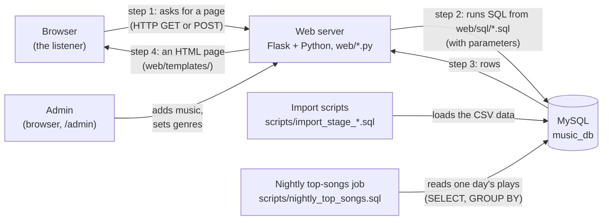

# music_db: the website

> A small music website where listeners browse artists, albums and songs, ♥ the songs
> they love, build playlists, and review albums.

The website is a **Python + Flask** app in the folder `web/`. It runs on your computer and
uses the MySQL database `music_db` (see [design.md](design.md) for the tables). How to
start it is in the [README](../README.md).

---

## 1. How one page works



1. The browser asks for a page, for example `/albums/101`.
2. The web server runs the SQL for that page. It borrows a connection from a **pool**: a few
   connections that stay open, because opening a new one for every page is slow.
3. MySQL sends back the rows.
4. The web server puts the rows into an HTML page and sends it to the browser.

**The browser never talks to MySQL directly.** Only the web server knows the database
password.

**No email service.** A paid email service is not worth it for this project. So the
nightly job's idea (each listener's top songs) is shown on the website instead, on the
"My top songs" page.

---

## 2. The pages

| Page | Address | Who can see it | Tables it uses |
|---|---|---|---|
| Home | `/` | everyone | `play`, `song`, `album`, `artist`, `review`, `genre`, `song_genre` |
| Artists | `/artists` | everyone | `artist`, `album`, `song` |
| One artist | `/artists/<id>` | everyone | `artist`, `album`, `song`, `song_genre`, `genre`, `favorite` |
| One album | `/albums/<id>` | everyone | `album`, `artist`, `song`, `song_genre`, `genre`, `favorite`, `review`, `listener` |
| Genres, one genre | `/genres`, `/genres/<id>` | everyone | `genre`, `song_genre`, `song`, `album`, `artist` |
| Search | `/search?q=...` | everyone | `song`, `album`, `artist` (with `LIKE`) |
| Sign up, Log in | `/signup`, `/login` | everyone | `listener` |
| My favorites | `/me/favorites` | logged in | `favorite`, `song`, `album`, `artist` |
| My playlists, one playlist | `/me/playlists`, `/playlists/<id>` | the owner only | `playlist`, `playlist_song`, `song`, `album`, `artist` |
| My top songs | `/me/top` | logged in | `play`, `song`, `album`, `artist`, `song_genre`, `genre` |
| Admin page | `/admin` | the admin password | `artist`, `album`, `song`, `song_genre`, `genre` |

The buttons change data:

| Button | What the SQL does |
|---|---|
| ♥ | `INSERT` into `favorite`, or `DELETE` it again |
| ▶ Play | `INSERT` into `play` (no real sound) |
| + Add to playlist | `INSERT` into `playlist_song`, at the next position |
| Move up / down | swaps the `position` of two rows in `playlist_song` |
| Remove | `DELETE` from `playlist_song`, then the songs after it move up one place |
| Post review | `INSERT` into `review`, or `UPDATE` my old review (`ON DUPLICATE KEY UPDATE`) |
| Sign up | `INSERT` into `listener` |
| Admin forms | `INSERT` into `artist`, `album`, `song` and `song_genre` |

---

## 3. Where the SQL lives

Every SQL statement the website runs is in a `.sql` file in `web/sql/`, under a name:

```sql
-- name: album_by_id
-- One album, with its artist and its review numbers.
SELECT ... FROM album a JOIN artist ar ON ar.artist_id = a.artist_id
WHERE a.album_id = %(album_id)s;
```

The Python code only calls it by its name: `db.one("catalog.album_by_id", album_id=101)`.

| File | What is in it |
|---|---|
| `web/sql/catalog.sql` | the pages everyone can see |
| `web/sql/account.sql` | sign up and log in |
| `web/sql/library.sql` | favorites, plays, playlists, my top songs |
| `web/sql/reviews.sql` | reviews |
| `web/sql/admin.sql` | the admin page |

**"Under the hood":** at the bottom of every page, this box lists the SQL statements that
page just ran, how many rows each one returned, and how long it took.

---

## 4. Keeping it safe

| Danger | What the website does |
|---|---|
| Someone types SQL into a form (SQL injection) | Every value is a **parameter** (`%(name)s`): it is sent separately from the SQL, so it can never change the SQL. |
| Passwords are stolen from the database | The database never has the real password, only a **hash** (a scrambled version that can't be turned back). Migration 012 added `listener.password_hash`. |
| Another website sends a hidden form (CSRF) | Every form has a secret token that only our pages know. A form without it is refused. |
| Someone opens another listener's playlist | The SQL checks the owner: `WHERE playlist_id = ... AND listener_id = <me>`. Not mine → "page not found". |
| A bug drops a table | The website logs in as `music_app`, a MySQL user that can only `SELECT`, `INSERT`, `UPDATE` and `DELETE`. |
| The passwords end up on GitHub | They are in the private `.env` file, which is in `.gitignore`. |

---

## 5. Transactions

A **transaction** is a group of SQL statements that are saved together, or not at all.
The website uses one when a single action needs more than one statement:

- **Add a song** (admin): `INSERT` the song, then one `INSERT` into `song_genre` for each
  genre. If a genre fails, the song is not saved either.
- **Set a song's genres** (admin): `DELETE` the old `song_genre` rows, then `INSERT` the new ones.
- **Move a song up** in a playlist: `UNIQUE (playlist_id, position)` refuses two songs in
  one place, so the song first waits at a free place after the last song, then the two
  songs swap.
- **Remove a song** from a playlist: `DELETE` it, then the songs after it move up one place
  (`UPDATE ... ORDER BY position`), so the places stay 1, 2, 3...

---

## 6. The database checks the website

The website lets the database's constraints have the last word. It turns their errors into
friendly messages:

| Constraint | When it says no | The message |
|---|---|---|
| `UNIQUE (username)`, `UNIQUE (email)` | sign up with a name or email that is taken | "This username is taken." |
| `UNIQUE (listener_id, playlist_name)` | two playlists with the same name | "You already have a playlist called ..." |
| Two-column key of `playlist_song` | the same song twice in a playlist | "That song is already in ..." |
| `UNIQUE (album_id, track_number)` | two "track 1"s on one album | "That album already has a track 1." |
| `CHECK (stars BETWEEN 1 AND 5)` | a review with 0 or 6 stars | "Stars must be 1 to 5." |
| Foreign keys | a song or album that does not exist | "page not found" (404) |

---

## 7. Files

| File | What it is |
|---|---|
| `web/__init__.py` | starts the app: reads `.env`, opens the database pool, adds the pages |
| `web/db.py` | the connection pool, and reading and running the SQL files |
| `web/security.py` | login checks, CSRF tokens, safe redirects |
| `web/catalog.py`, `account.py`, `library.py`, `reviews.py`, `admin.py` | the pages, one file for each part of the website |
| `web/sql/*.sql` | every SQL statement the website runs |
| `web/templates/*.html` | the pages (HTML with Jinja), `macros.html` has the shared parts |
| `web/static/` | the design (`style.css`), a little JavaScript, the icon |
| `migrations/012_add_listener_password.sql` | the one database change the website needed |
| `scripts/demo_passwords.sql` | gives every practice listener the password `music330` |
