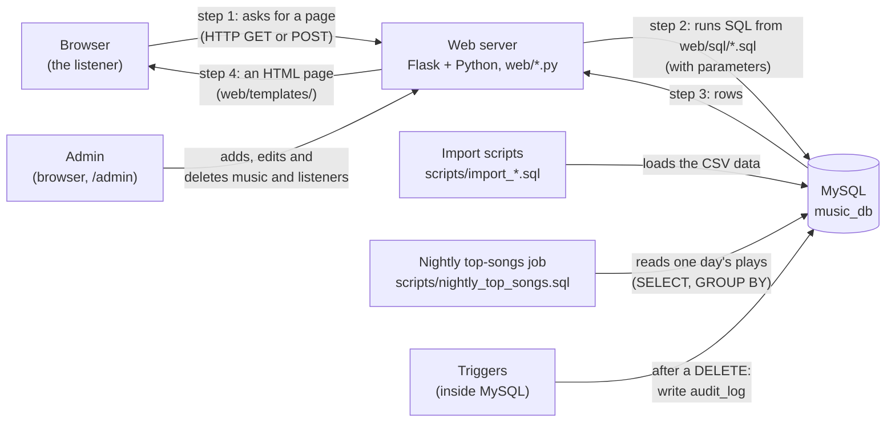

# music_db: the website

> A small music website where listeners browse artists, albums and songs, ♥ the songs
> they love, build playlists, and review albums.

The website is a **Python + Flask** app in the folder `web/`. It runs on your computer and
uses the MySQL database `music_db` (see [design.md](design.md) for the tables). How to
start it is in the [README](../README.md). A short tour for a presentation is in
[demo.md](demo.md).

---

## 1. How one page works



1. The browser asks for a page, for example `/albums/101`.
2. The web server runs the SQL for that page. It borrows a connection from a **pool**: a few
   connections that stay open, because opening a new one for every page is slow. If all of
   them are busy, the page waits a moment for one to come back.
3. MySQL sends back the rows.
4. The web server puts the rows into an HTML page and sends it to the browser.

**The browser never talks to MySQL directly.** Only the web server knows the database
password.

**No email service.** A paid email service is not worth it for this project. So the
nightly job's idea (each listener's top songs) is shown on the website instead, on the
"My top songs" page.

---

## 2. The pages

| Page | Address | Who can see it | What it shows |
|---|---|---|---|
| Home | `/` | everyone | most played, most loved, "What's new", top rated, newest albums |
| Songs | `/songs` | everyone | every song, with filters, a sort and pages |
| Albums, one album | `/albums`, `/albums/<id>` | everyone | filters and sorts; an album's songs, reviews and comments, who loves it |
| Artists, one artist | `/artists`, `/artists/<id>` | everyone | filters and sorts; an artist's songs and albums |
| Genres, one genre | `/genres`, `/genres/<id>` | everyone | the genres and their songs |
| Charts | `/charts` | everyone | plays per day, top 3 in every genre, the best album of each decade |
| Listeners, a profile | `/listeners`, `/listeners/<username>` | everyone | each listener's taste, favorites, reviews, comments, last 30 days |
| Search | `/search?q=...` | everyone | songs, artists and albums (`FULLTEXT`, or `LIKE` for short words) |
| The Lab | `/lab`, `/lab/security`, `/lab/speed`, `/lab/two-browsers` | everyone | how the website and the database work |
| Sign up, Log in | `/signup`, `/login` | everyone | |
| My favorites | `/me/favorites` | logged in | the songs I ♥ |
| My playlists, one playlist | `/me/playlists`, `/playlists/<id>` | the owner only | playlists in my own order |
| My top songs | `/me/top` | logged in | my plays: top songs, genres, weekdays |
| My account | `/me/account` | logged in | change my email or password, delete my account |
| Admin pages | `/admin/...` | the admin password | CRUD for music and listeners, moderation, reports, audit log |

The buttons change data:

| Button | What the SQL does |
|---|---|
| ♥ | `INSERT` into `favorite`, or `DELETE` it again |
| ▶ Play | `INSERT` into `play` (no real sound) |
| + Add to playlist | `INSERT` into `playlist_song`, at the next position (a transaction with a lock) |
| Move up / down | swaps the `position` of two rows in `playlist_song` |
| Remove | `DELETE` from `playlist_song`, then the songs after it move up one place |
| Post review | `INSERT` into `review`, or `UPDATE` my old review (`ON DUPLICATE KEY UPDATE`) |
| Reply (a comment) | `INSERT` into `review_comment` |
| Sign up | `INSERT` into `listener` |
| My account | `UPDATE listener` (email, password), `DELETE FROM listener` (everything else goes too) |
| Admin forms | `INSERT`, `UPDATE` and `DELETE` on `artist`, `album`, `song`, `song_genre`, `listener`, `review`, `review_comment` |

---

## 3. Filters, sorts and pages

The list pages (Songs, Albums, Artists, Listeners) have menus: "Genre", "Year", "Sort by"
and more. Each choice changes the SQL, and "Under the hood" shows it.

A list's statement is in the `.sql` file with **places** for the chosen pieces, and the
pieces are written right after it:

```sql
-- name: browse_songs
SELECT ... FROM song s JOIN public_album a ... JOIN artist ar ...
{where}
ORDER BY {order}
LIMIT %(limit)s OFFSET %(offset)s;

-- where: state
ar.origin_state = %(state)s
-- where: medium
s.duration_seconds BETWEEN 180 AND 300
-- sort: loved
love_count DESC, s.song_id
```

- The visitor only chooses pieces **by name** (`?state=WA&sort=loved`). A name that is not
  in the file is ignored. So nobody can put their own SQL into the statement.
- The values (like `WA`) are still parameters.
- Filters on a total use `HAVING` (`{having}`), like "4★ or more": `AVG(r.stars) >= %(stars)s`.
  `WHERE` can't do that, because it runs before `GROUP BY`.
- `COUNT(*) OVER ()` (a window function) counts all the matching rows before `LIMIT`, so one
  query gives the page **and** the number of pages.

---

## 4. Where the SQL lives

Every SQL statement the website runs is in a `.sql` file in `web/sql/`, under a name:

```sql
-- name: album_by_id
-- One album, with its artist, its number of songs, and its rating.
SELECT ... FROM album a JOIN artist ar ON ar.artist_id = a.artist_id
WHERE a.album_id = %(album_id)s;
```

The Python code only calls it by its name: `db.one("catalog.album_by_id", album_id=101)`.

| File | What is in it |
|---|---|
| `web/sql/catalog.sql` | the music pages everyone can see, the filters, the search |
| `web/sql/charts.sql` | the Charts page (window functions, CTEs) |
| `web/sql/community.sql` | the Listeners page and the profiles |
| `web/sql/account.sql` | sign up, log in, My account, deleting a listener |
| `web/sql/library.sql` | favorites, plays, playlists, my top songs |
| `web/sql/reviews.sql` | reviews and comments |
| `web/sql/admin.sql` | the admin pages (CRUD, moderation, audit log) |
| `web/sql/reports.sql` | the admin's reports |
| `web/sql/lab.sql` | the Lab pages |

**"Under the hood":** at the bottom of every page, this box lists the SQL statements that
page just ran, their parameters, how many rows each one returned, and how long it took.

---

## 5. Keeping it safe

| Danger | What the website does |
|---|---|
| Someone types SQL into a form (SQL injection) | Every value is a **parameter** (`%(name)s`): it is sent separately from the SQL, so it can never change the SQL. The Lab shows it: `/lab/security`. |
| Someone types SQL into the address (`?sort=...`) | Only sorts and filters from a fixed list in the `.sql` file are used. Everything else is ignored. |
| Passwords are stolen from the database | The database never has the real password, only a **hash** (a scrambled version that can't be turned back). Migration 012 added `listener.password_hash`. |
| Another website sends a hidden form (CSRF) | Every form has a secret token that only our pages know. A form without it is refused. |
| Someone opens another listener's playlist or deletes their comment | The SQL checks the owner: `WHERE ... AND listener_id = <me>`. |
| Someone sees other people's emails | Emails are shown only on "My account" (your own) and to the admin. Profiles never show them. |
| A bug drops a table | The website logs in as `music_app`, a MySQL user that can only `SELECT`, `INSERT`, `UPDATE` and `DELETE`. |
| The passwords end up on GitHub | They are in the private `.env` file, which is in `.gitignore`. |

---

## 6. Transactions and locks

A **transaction** is a group of SQL statements that are saved together, or not at all.
The website uses one when a single action needs more than one statement:

- **Add a song** (admin): `INSERT` the song, then one `INSERT` into `song_genre` for each
  genre. If a genre fails, the song is not saved either.
- **Set a song's genres** (admin): `DELETE` the old `song_genre` rows, then `INSERT` the new ones.
- **Add a song to a playlist**: first `SELECT ... FOR UPDATE` locks the playlist's row,
  then it finds the next position and inserts. If two browsers add to the same playlist
  at the same moment, the second one waits until the first one is finished, so they
  can't both take the same position. (Tested: 12 adds at the same moment give places 1 to 12.)
- **Move a song up** in a playlist: `UNIQUE (playlist_id, position)` refuses two songs in
  one place, so the song first waits at a free place after the last song, then the two
  songs swap.
- **Remove a song** from a playlist: `DELETE` it, then the songs after it move up one place
  (`UPDATE ... ORDER BY position`), so the places stay 1, 2, 3...
- **Delete a listener**: `SET @audit_actor = ...` (who does it), then `DELETE`. The trigger
  writes the audit row in the same transaction.

---

## 7. The database checks the website

The website lets the database's constraints have the last word. It turns their errors into
friendly messages:

| Constraint | When it says no | The message |
|---|---|---|
| `UNIQUE (username)`, `UNIQUE (email)` | sign up, or change an email, to one that is taken | "This username is taken." |
| `UNIQUE (listener_id, playlist_name)` | two playlists with the same name | "You already have a playlist called ..." |
| Two-column key of `playlist_song` | the same song twice in a playlist | "That song is already in ..." |
| `UNIQUE (album_id, track_number)` | two "track 1"s on one album | "That album already has a track 1." |
| `CHECK (stars BETWEEN 1 AND 5)` | a review with 0 or 6 stars | "Stars must be 1 to 5." |
| `CHECK (CHAR_LENGTH(TRIM(comment_text)) >= 1)` | a comment with no words | "A comment needs some words." |
| Foreign keys (when adding) | a song, album or review that does not exist | "page not found" (404) |
| Foreign keys with `RESTRICT` (when deleting) | the admin deletes a song that listeners love, an album with songs or reviews, an artist with albums | "MySQL said no: listeners still ♥ this song (foreign key fk_favorite_song, RESTRICT)." |

And `ON DELETE CASCADE` does the opposite: deleting a listener deletes everything that
belongs to them. "My account" and the admin's listener page show the list first.

---

## 8. Files

| File | What it is |
|---|---|
| `web/__init__.py` | starts the app: reads `.env`, opens the database pool, adds the pages |
| `web/db.py` | the connection pool, reading the SQL files, and putting the filter pieces into a statement |
| `web/lists.py` | reads the filters from the address safely, and counts the pages |
| `web/security.py` | login checks, CSRF tokens, safe redirects |
| `web/catalog.py`, `community.py`, `account.py`, `library.py`, `reviews.py`, `admin.py`, `lab.py` | the pages, one file for each part of the website |
| `web/sql/*.sql` | every SQL statement the website runs |
| `web/templates/*.html` | the pages (HTML with Jinja), `macros.html` has the shared parts |
| `web/static/` | the design (`style.css`), a little JavaScript, the icon |
| `migrations/012` to `016` | the database changes the website needed (see [design.md](design.md)) |
| `scripts/import_content.sql`, `data/content/` | the content pack: more made-up data |
| `scripts/demo_passwords.sql` | gives every practice listener the password `music330` |
| `run.sh` | sets everything up and starts the website with one command |
