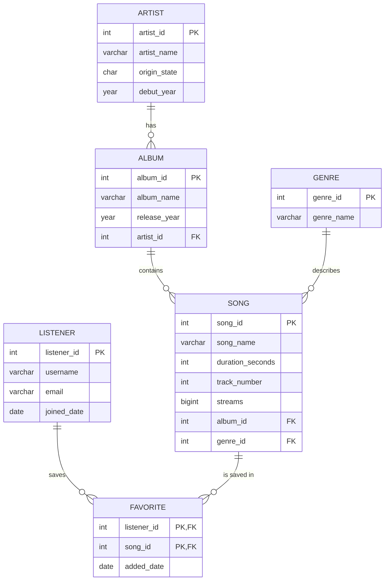

# music_db: design

> A small music website where listeners browse artists, albums and songs, and save
> their own favorite songs and playlists.

This document explains the system as it is now: the website, the parts around the
database, the tables, and how the database grows in 4 stages.

---

## 1. The system

The **website is imaginary**: it is designed and drawn, but not built. Everything that
touches the database is **real** and lives in this repo.

| Part | From stage | Real or imaginary | What it does with the data |
|---|---|---|---|
| Listener website | 1 | imaginary | browse and search music; sign up; ♥ a song |
| API server | 1 | imaginary | gets requests from the website and the admin page, and runs the SQL |
| MySQL database `music_db` | 1 | **real** | stores everything |
| Import scripts | 1 | **real** | load the CSV files in `data/` into the tables (one script per stage) |
| Admin page | 2 | imaginary | adds artists, albums and songs |

- The API server sits between the website and the database. A browser must never talk
  to MySQL directly, because then everyone could see the database password.
- There is no real sound. Playing music is not part of the system.

Each stage file has a picture of the system at that stage.

---

## 2. The stages

The database grows in 4 stages. Each stage is a set of migrations (small numbered SQL
files, run in order), and each finished stage gets a git tag.

| Stage | New tables | Tables in total | Status |
|---|---|---|---|
| 1 | `artist`, `album`, `song`, `genre` | 4 | **built** (tag `stage-1`, see [stage-1.md](stage-1.md)) |
| 2 | `listener`, `favorite` | 6 | **built** (tag `stage-2`, see [stage-2.md](stage-2.md)) |
| 3 | playlists and plays | | planned |
| 4 | more genres per song, and reviews | | planned |

---

## 3. ER diagram (now: Stages 1 and 2)

---

## 4. The tables

### Stage 1: the music catalog

**`artist`**: one row for each artist.

| Column | Key | Notes |
|---|---|---|
| `artist_id` | PK | |
| `artist_name` | | required |
| `origin_state` | | US state, 2 letters, like `WA`. Can be empty. |
| `debut_year` | | the year the artist started |

**`album`**: one row for each album.

| Column | Key | Notes |
|---|---|---|
| `album_id` | PK | |
| `album_name` | | can be empty |
| `release_year` | | the year the album came out |
| `artist_id` | FK → `artist` | required |

**`genre`**: one row for each genre, like Rock or Pop.

| Column | Key | Notes |
|---|---|---|
| `genre_id` | PK | |
| `genre_name` | | required, unique |

**`song`**: one row for each song.

| Column | Key | Notes |
|---|---|---|
| `song_id` | PK | |
| `song_name` | | can be empty |
| `duration_seconds` | | how long the song is |
| `track_number` | | the place of the song on its album |
| `streams` | | streams on **other** music services, from the CSV (`BIGINT`) |
| `album_id` | FK → `album` | required |
| `genre_id` | FK → `genre` | required |

Extra rule: `UNIQUE (album_id, track_number)`. One album cannot have two "track 1"s.

Every `_id` primary key is `AUTO_INCREMENT`: a new row gets the next number by itself.

### Stage 2: listeners and favorites

**`listener`**: one row for each person who uses the website.

| Column | Key | Notes |
|---|---|---|
| `listener_id` | PK | |
| `username` | | required, unique |
| `email` | | required, unique |
| `joined_date` | | the day they signed up (default: today) |

**`favorite`**: one row for "this listener loves this song".

| Column | Key | Notes |
|---|---|---|
| `listener_id` | PK, FK → `listener` | deleted together with the listener (`ON DELETE CASCADE`) |
| `song_id` | PK, FK → `song` | |
| `added_date` | | the day they pressed ♥ (default: today) |

---

## 5. Relationships

| Relationship | In words |
|---|---|
| `artist` 1 — 0..many `album` | One artist has zero or more albums. Each album has exactly one artist. |
| `album` 1 — 0..many `song` | One album has zero or more songs. Each song is on exactly one album. |
| `genre` 1 — 0..many `song` | One genre has zero or more songs. Each song has exactly one genre. |
| `listener` 1 — 0..many `favorite` | One listener has zero or more favorites. Each favorite belongs to exactly one listener. |
| `song` 1 — 0..many `favorite` | One song is loved zero or more times. Each favorite is for exactly one song. |

`listener` and `song` are **many-to-many**, through `favorite`.

A parent can have no children (some artists have no albums yet). But a child always
needs its parent, because every foreign key is required (`NOT NULL`).

---

## 6. Why it is built like this

The database is in **3NF**. The important choices:

- **`song` has no `artist_id`.** The artist depends on the album, not on the song. A
  copy in `song` could say "artist A" while the album says "artist B". To find a song's
  artist, join `song` → `album` → `artist`.
- **`genre_name` lives only in `genre`.** In `song`, it would depend on `genre_id`,
  which is not the key.
- **`favorite` has a two-column key** (`listener_id`, `song_id`). A listener cannot love
  the same song twice. Its only other column, `added_date`, depends on the whole key
  (2NF). A column like `username` would not belong here, because it depends only on
  `listener_id`.
- **What happens on DELETE.** A favorite **belongs to** a listener, so when a listener
  deletes their account, their favorites are deleted too (`ON DELETE CASCADE`). The
  music is protected: a song that someone loves, or an artist who still has albums,
  cannot be deleted.
- **`streams` is a `BIGINT`.** An `INT` stops at about 2.1 billion, and one song already
  has 1,847,621,533 streams. It counts streams on **other** music services.
- **Constraints have names** (like `fk_song_genre`). Error messages show the name, and a
  later migration can remove a constraint by its name.

---

## 7. Files

| File | What it is |
|---|---|
| `docs/design.md` | this document |
| `docs/stage-1.md`, `docs/stage-2.md` | the diagrams for each stage |
| `migrations/` | the migrations: small numbered SQL files, run in order |
| `scripts/import_stage_1.sql`, `import_stage_2.sql` | load each stage's CSV files |
| `scripts/build.sql` | builds the whole database from zero, stage by stage |
| `data/` | made-up practice data (CSV files), generated with AI |
