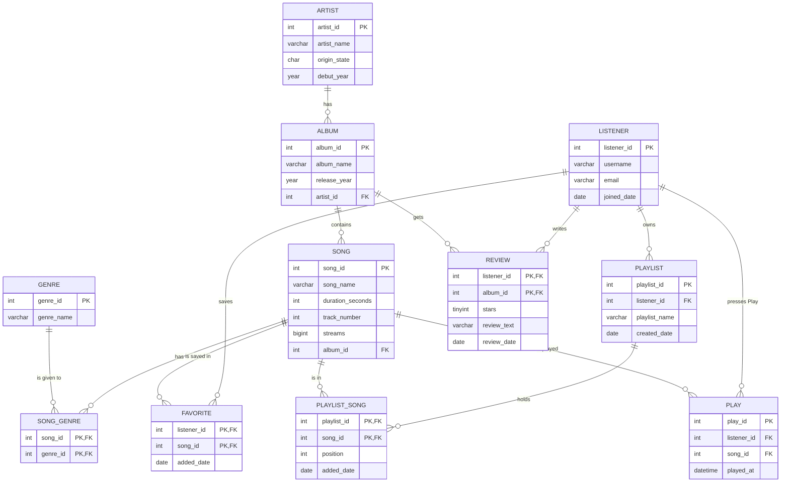

# music_db: design

> A small music website where listeners browse artists, albums and songs, and save
> their own favorite songs and playlists.

This document explains the system as it is now: the website, the parts around the
database, the tables, and how the database grows in 4 stages.

---

## 1. The system

The **website is imaginary**: it is designed and drawn, but not built. Everything that
touches the database is **real** and lives in this repo.

| Part | From stage | Real or imaginary | What it does with the data |
|---|---|---|---|
| Listener website | 1 | imaginary | browse and search music; sign up; ♥ a song; make playlists; press Play; write a review |
| API server | 1 | imaginary | gets requests from the website and the admin page, and runs the SQL |
| MySQL database `music_db` | 1 | **real** | stores everything |
| Import scripts | 1 | **real** | load the CSV files in `data/` into the tables (one script per stage) |
| Admin page | 2 | imaginary | adds artists, albums and songs; from Stage 4 also sets a song's genres |
| Nightly top-songs job | 3 | **real** (a SQL file, run by hand) | reads yesterday's plays and makes each listener's top songs |
| Email service | 3 | outside service (imaginary) | sends each listener their top songs |

- The API server sits between the website and the database. A browser must never talk
  to MySQL directly, because then everyone could see the database password.
- There is no real sound. Playing music is not part of the system.

Each stage file has a picture of the system at that stage.

---

## 2. The stages

The database grows in 4 stages. Each stage is a set of migrations (small numbered SQL
files, run in order), and each finished stage gets a git tag.

| Stage | New tables | Tables in total | Status |
|---|---|---|---|
| 1 | `artist`, `album`, `song`, `genre` | 4 | **built** (tag `stage-1`, see [stage-1.md](stage-1.md)) |
| 2 | `listener`, `favorite` | 6 | **built** (tag `stage-2`, see [stage-2.md](stage-2.md)) |
| 3 | `playlist`, `playlist_song`, `play` | 9 | **built** (tag `stage-3`, see [stage-3.md](stage-3.md)) |
| 4 | `song_genre`, `review` | 11 | **built** (tag `stage-4`, see [stage-4.md](stage-4.md)) |

In Stage 4, `song_genre` replaces the column `song.genre_id`, so that one song can have
more than one genre.

---

## 3. ER diagram (the full design, after Stage 4)

Each stage file has the diagram for that stage.

---

## 4. The tables

### Stage 1: the music catalog

**`artist`**: one row for each artist.

| Column | Key | Notes |
|---|---|---|
| `artist_id` | PK | |
| `artist_name` | | required |
| `origin_state` | | US state, 2 letters, like `WA`. Can be empty. |
| `debut_year` | | the year the artist started |

**`album`**: one row for each album.

| Column | Key | Notes |
|---|---|---|
| `album_id` | PK | |
| `album_name` | | can be empty |
| `release_year` | | the year the album came out |
| `artist_id` | FK → `artist` | required |

**`genre`**: one row for each genre, like Rock or Pop.

| Column | Key | Notes |
|---|---|---|
| `genre_id` | PK | |
| `genre_name` | | required, unique |

**`song`**: one row for each song.

| Column | Key | Notes |
|---|---|---|
| `song_id` | PK | |
| `song_name` | | can be empty |
| `duration_seconds` | | how long the song is |
| `track_number` | | the place of the song on its album |
| `streams` | | streams on **other** music services, from the CSV (`BIGINT`) |
| `album_id` | FK → `album` | required |
| `genre_id` | FK → `genre` | required. **Removed in Stage 4** (moved to `song_genre`). |

Extra rule: `UNIQUE (album_id, track_number)`. One album cannot have two "track 1"s.

Every `_id` primary key is `AUTO_INCREMENT`: a new row gets the next number by itself.

### Stage 2: listeners and favorites

**`listener`**: one row for each person who uses the website.

| Column | Key | Notes |
|---|---|---|
| `listener_id` | PK | |
| `username` | | required, unique |
| `email` | | required, unique |
| `joined_date` | | the day they signed up (default: today) |

**`favorite`**: one row for "this listener loves this song".

| Column | Key | Notes |
|---|---|---|
| `listener_id` | PK, FK → `listener` | deleted together with the listener (`ON DELETE CASCADE`) |
| `song_id` | PK, FK → `song` | |
| `added_date` | | the day they pressed ♥ (default: today) |

### Stage 3: playlists and plays

**`playlist`**: one row for each playlist.

| Column | Key | Notes |
|---|---|---|
| `playlist_id` | PK | |
| `listener_id` | FK → `listener` | required (the owner). Deleted together with the listener (`ON DELETE CASCADE`). |
| `playlist_name` | | required |
| `created_date` | | the day it was made (default: today) |

Extra rule: `UNIQUE (listener_id, playlist_name)`. One listener cannot have two
playlists with the same name. (Two different listeners can.)

**`playlist_song`**: one row for "this song is in this playlist, at this place".

| Column | Key | Notes |
|---|---|---|
| `playlist_id` | PK, FK → `playlist` | deleted together with the playlist (`ON DELETE CASCADE`) |
| `song_id` | PK, FK → `song` | |
| `position` | | the order: 1, 2, 3… (`CHECK (position >= 1)`) |
| `added_date` | | the day the song was added (default: today) |

Extra rule: `UNIQUE (playlist_id, position)`. Two songs cannot have the same place in
one playlist.

**`play`**: one row each time a listener presses Play.

| Column | Key | Notes |
|---|---|---|
| `play_id` | PK | |
| `listener_id` | FK → `listener` | required. Deleted together with the listener (`ON DELETE CASCADE`). |
| `song_id` | FK → `song` | required |
| `played_at` | | the date and time (default: now) |

### Stage 4: more genres per song, and reviews

**`song_genre`**: one row for "this song has this genre". It replaces `song.genre_id`.

| Column | Key | Notes |
|---|---|---|
| `song_id` | PK, FK → `song` | deleted together with the song (`ON DELETE CASCADE`) |
| `genre_id` | PK, FK → `genre` | a genre that songs still use cannot be deleted |

**`review`**: one row for "this listener gives this album some stars".

| Column | Key | Notes |
|---|---|---|
| `listener_id` | PK, FK → `listener` | deleted together with the listener (`ON DELETE CASCADE`) |
| `album_id` | PK, FK → `album` | an album with reviews cannot be deleted |
| `stars` | | required, 1 to 5: `CHECK (stars BETWEEN 1 AND 5)` |
| `review_text` | | optional (up to 500 characters) |
| `review_date` | | the day it was written (default: today) |

---

## 5. Relationships

| Relationship | In words |
|---|---|
| `artist` 1 — 0..many `album` | One artist has zero or more albums. Each album has exactly one artist. |
| `album` 1 — 0..many `song` | One album has zero or more songs. Each song is on exactly one album. |
| `genre` 1 — 0..many `song` | Stages 1–3 only: one genre has zero or more songs. Each song has exactly one genre. |
| `listener` 1 — 0..many `favorite` | One listener has zero or more favorites. Each favorite belongs to exactly one listener. |
| `song` 1 — 0..many `favorite` | One song is loved zero or more times. Each favorite is for exactly one song. |
| `listener` 1 — 0..many `playlist` | One listener has zero or more playlists. Each playlist has exactly one owner. |
| `playlist` 1 — 0..many `playlist_song` | One playlist holds zero or more songs. |
| `song` 1 — 0..many `playlist_song` | One song is in zero or more playlists. |
| `listener` 1 — 0..many `play` | One listener has zero or more plays. Each play belongs to exactly one listener. |
| `song` 1 — 0..many `play` | One song is played zero or more times. Each play is for exactly one song. |
| `song` 1 — 0..many `song_genre` | Stage 4: one song has zero or more genres. |
| `genre` 1 — 0..many `song_genre` | Stage 4: one genre is given to zero or more songs. |
| `listener` 1 — 0..many `review` | One listener writes zero or more reviews. Each review has exactly one writer. |
| `album` 1 — 0..many `review` | One album gets zero or more reviews. Each review is for exactly one album. |

Many-to-many relationships:

- `listener` and `song`, through `favorite` (loved once)
- `playlist` and `song`, through `playlist_song`
- `listener` and `song`, through `play` (played many times)
- `song` and `genre`, through `song_genre` (Stage 4)
- `listener` and `album`, through `review`

A parent can have no children (some artists have no albums yet). But a child always
needs its parent, because every foreign key is required (`NOT NULL`).

---

## 6. Why it is built like this

The database is in **3NF**. The important choices:

- **`song` has no `artist_id`.** The artist depends on the album, not on the song. A
  copy in `song` could say "artist A" while the album says "artist B". To find a song's
  artist, join `song` → `album` → `artist`.
- **`genre_name` lives only in `genre`.** In `song`, it would depend on `genre_id`,
  which is not the key.
- **`favorite` has a two-column key** (`listener_id`, `song_id`). A listener cannot love
  the same song twice. Its only other column, `added_date`, depends on the whole key
  (2NF). A column like `username` would not belong here, because it depends only on
  `listener_id`.
- **`favorite` and `play` look alike, but their keys are different.** You love a song
  only once, so `favorite` uses the two-column key. You can play a song many times, so
  `play` needs its own `play_id`.
- **`playlist_song` is a junction table with extra data.** `position` (the order) and
  `added_date` depend on the whole key: this song, in this playlist (2NF).
- **`playlist` does not save its owner's `username`.** It would depend on
  `listener_id`, which is not the key (3NF).
- **`playlist` has no "number of songs" column.** We count the rows in
  `playlist_song` instead. We don't save what we can calculate.
- **`streams` is not a copy of `play`.** `song.streams` is the count from **other**
  music services (from the CSV). `play` is the plays on **our** website. These are two
  different facts.
- **What happens on DELETE.** Favorites, playlists, plays and reviews **belong to** a
  listener, so when a listener deletes their account, they are deleted too (`ON DELETE
  CASCADE`). When a playlist is deleted, its `playlist_song` rows go with it, and when
  a song is deleted, its `song_genre` rows go with it. The music is protected: a song
  that is loved, in a playlist or played, an album with reviews, a genre that songs
  use, or an artist who still has albums, cannot be deleted.
- **`streams` is a `BIGINT`.** An `INT` stops at about 2.1 billion, and one song already
  has 1,847,621,533 streams. It counts streams on **other** music services.
- **Constraints have names** (like `fk_song_genre`). Error messages show the name, and a
  later migration can remove a constraint by its name.
- **The Stage 4 pivot: `song_genre`.** One column can hold only one genre, but a song
  can be Rock **and** Pop. `"Rock, Pop"` in one cell would break 1NF. So a migration
  makes the junction table `song_genre`, copies every song's genre into it, and then
  removes `song.genre_id` (first its foreign key `fk_song_genre`, by name). See
  [stage-4.md](stage-4.md).
- **`review` has a two-column key and a `CHECK`.** One listener writes one review for
  each album, and the database refuses stars outside 1 to 5. `stars`, `review_text`
  and `review_date` depend on the whole key: which listener **and** which album (2NF).

---

## 7. Files

| File | What it is |
|---|---|
| `docs/design.md` | this document |
| `docs/stage-1.md` … `stage-4.md` | the diagrams for each stage |
| `migrations/` | the migrations: small numbered SQL files, run in order |
| `scripts/import_stage_1.sql` … `import_stage_4.sql` | load each stage's CSV files |
| `scripts/nightly_top_songs.sql` | the nightly top-songs job (we run it by hand) |
| `scripts/build.sql` | builds the whole database from zero, stage by stage |
| `queries/showcase.sql` | the review feature from start to end: `INSERT`, a join with `WHERE`, `GROUP BY`, `DELETE` |
| `queries/test_constraints.sql` | 7 statements that **must fail**, one for each kind of constraint |
| `data/` | made-up practice data (CSV files), generated with AI |
