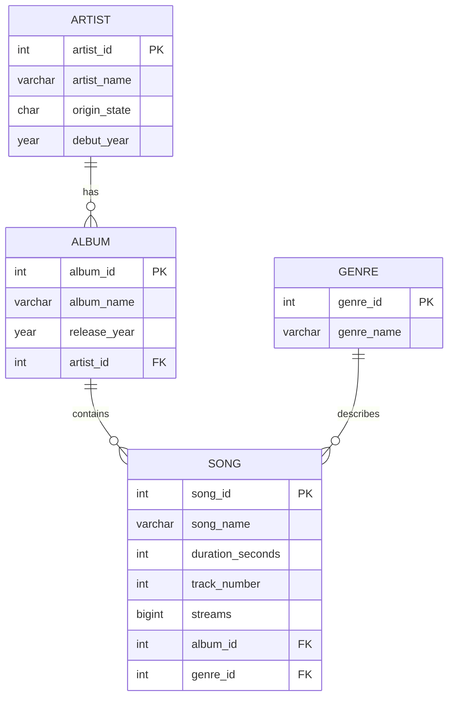
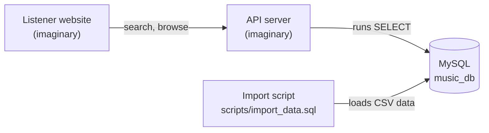

# Stage 1 (Week 7): the music catalog

**What changed and why:** the database starts with the music itself: artists, their
albums, the songs on each album, and genres. An import script loads the practice data,
and the (imaginary) listener website can browse and search it.

## Database (4 tables)

## The system around the database

## Files in this stage

| File | What it does |
|---|---|
| `migrations/001_create_artist.sql` | creates `artist` |
| `migrations/002_create_album.sql` | creates `album` (FK → `artist`) |
| `migrations/003_create_genre.sql` | creates `genre` (`genre_name` is unique) |
| `migrations/004_create_song.sql` | creates `song` (FK → `album`, FK → `genre`) |
| `scripts/import_data.sql` | loads `data/*.csv` into the 4 tables |
| `scripts/build.sql` | builds everything from zero, in order |
