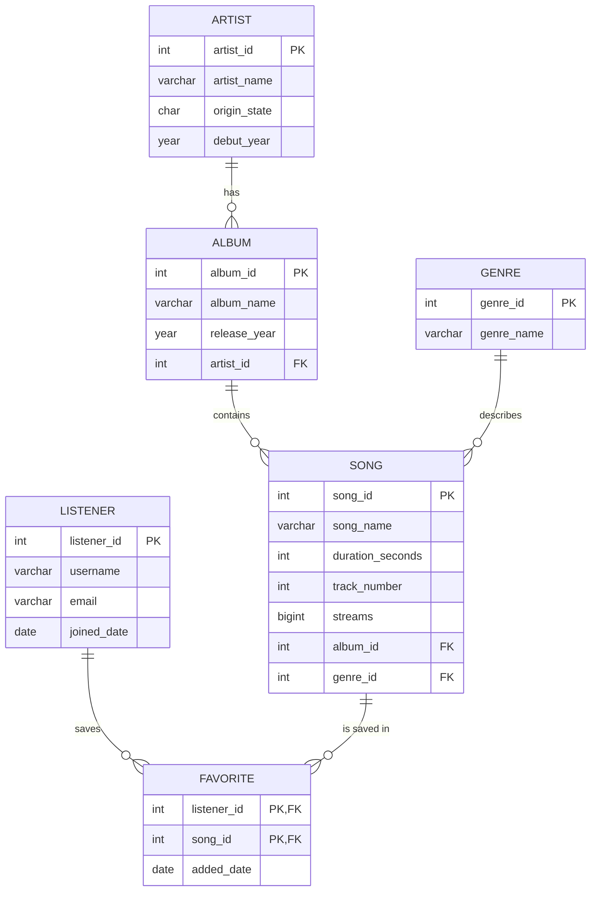
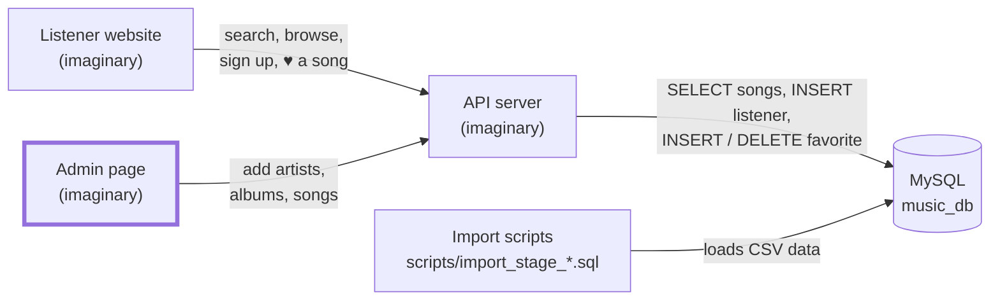

# Stage 2 (Week 8): listeners and favorites

> **Status: built** (git tag `stage-2`).

**What changed and why:** the website gets users. Listeners can sign up and save their
favorite songs (♥). This is the first many-to-many relationship: one listener loves many
songs, and one song is loved by many listeners. A new admin page lets the person who runs
the site add new music.

**New in this stage:** the tables `listener` and `favorite`, the admin page, and the
sign up and ♥ actions on the website. (New parts have a thick border in the system
picture.)

## Database (6 tables)

## The system around the database

## Why it is built like this

- **`favorite` is a junction table.** Many-to-many always needs its own table in the
  middle.
- **Two-column key** (`listener_id`, `song_id`): the same listener cannot love the same
  song twice.
- **2NF:** `added_date` depends on the whole key (which listener **and** which song).
  `username` in `favorite` would break 2NF, because it depends only on `listener_id`.
- **UNIQUE:** two listeners cannot have the same `username` or the same `email`.
- **What happens on DELETE:** a favorite **belongs to** a listener. If a listener
  deletes their account, their favorites are deleted too (`ON DELETE CASCADE`). But a
  song that someone loves cannot be deleted.
- **DEFAULT:** if the website does not give a date, `joined_date` and `added_date` are
  today.

## Files in this stage

| File | What it does |
|---|---|
| `migrations/005_create_listener.sql` | creates `listener` (`username` and `email` are unique) |
| `migrations/006_create_favorite.sql` | creates `favorite` (two-column key, two FKs) |
| `scripts/import_stage_2.sql` | loads the listeners, then their favorites |
| `scripts/build.sql` | now builds stage by stage: Stage 1 tables + data, then Stage 2 tables + data |
| `data/listener.csv`, `data/favorite.csv` | made-up practice data (40 listeners, 248 favorites) |

## Tested

- All data loads: 40 listeners, 248 favorites.
- The database refuses: the same username twice, the same email twice, loving the same
  song twice, a favorite for a song that does not exist, and deleting a song that
  someone loves.
- Deleting a listener deletes their favorites too.
