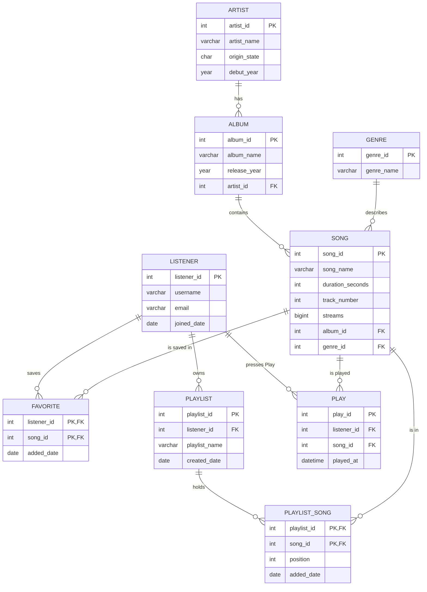
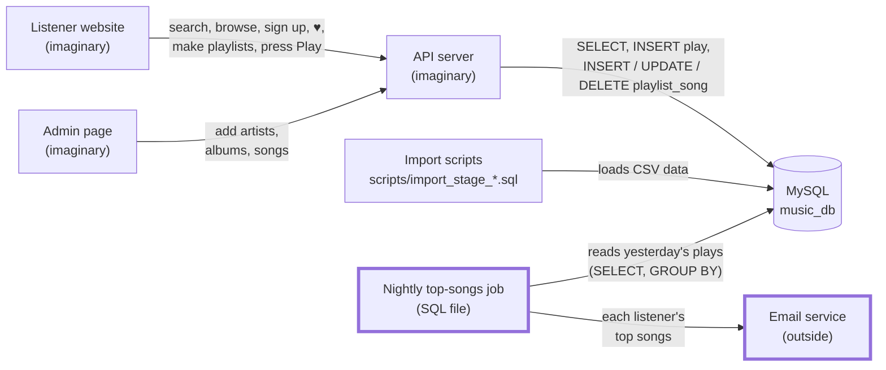

# Stage 3 (Week 9): playlists and plays

> **Status: built** (git tag `stage-3`).

**What changed and why:** listeners can make playlists and press Play. `playlist_song`
keeps the order of the songs (`position`), and `play` saves one row for every play, so
we can count the most played songs. A nightly job uses `play` to email each listener
their top songs, through an outside email service.

**New in this stage:** the tables `playlist`, `playlist_song` and `play`, the nightly
job, and the email service. (New parts have a thick border in the system picture.)

## Database (9 tables)

## The system around the database

## Why it is built like this

- **One-to-many:** one listener owns many playlists.
- **`playlist_song` is a junction table with extra data:** `position` (the order) and
  `added_date`. Both depend on the whole key (2NF).
- **`UNIQUE (playlist_id, position)`:** two songs cannot have the same place in one
  playlist. **`UNIQUE (listener_id, playlist_name)`:** one listener cannot have two
  playlists with the same name.
- **`favorite` vs `play`:** you love a song only once, so `favorite` has a two-column
  key. You can play a song many times, so `play` needs its own `play_id`.
- **Don't save what you can calculate:** `playlist` has no "number of songs" column. We
  count the rows in `playlist_song`.
- **`streams` is not a copy of `play`:** `song.streams` = streams on **other** services
  (from the CSV). `play` = plays on **our** website.

## Files in this stage

| File | What it does |
|---|---|
| `migrations/007_create_playlist.sql` | creates `playlist` (FK → `listener`) |
| `migrations/008_create_playlist_song.sql` | creates `playlist_song` (two-column key, `position`) |
| `migrations/009_create_play.sql` | creates `play` (its own key, two FKs) |
| `scripts/import_stage_3.sql` | loads the playlists, their songs, and the plays |
| `data/playlist.csv`, `data/playlist_song.csv`, `data/play.csv` | made-up practice data (43 playlists, 319 playlist rows, 2,456 plays) |
| `scripts/nightly_top_songs.sql` | the nightly job's query (we run it by hand) |
