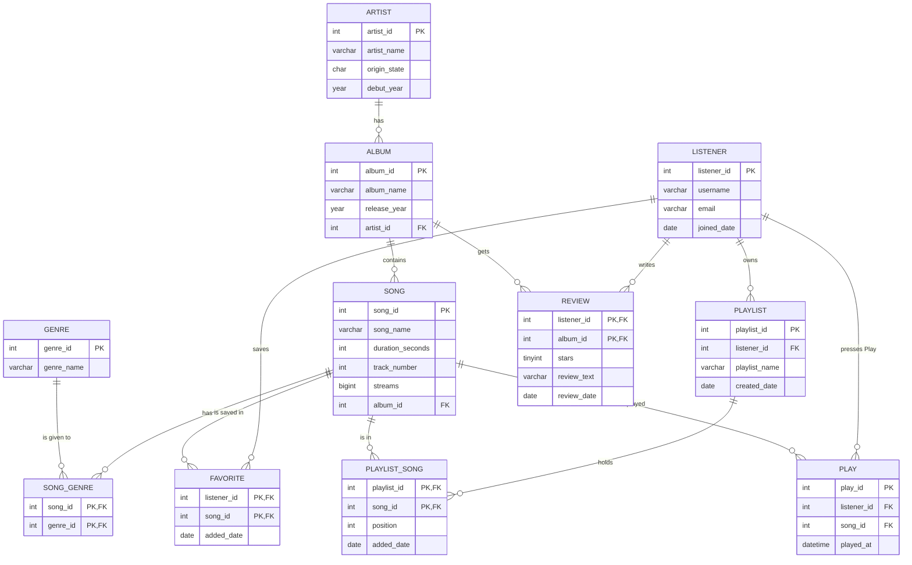
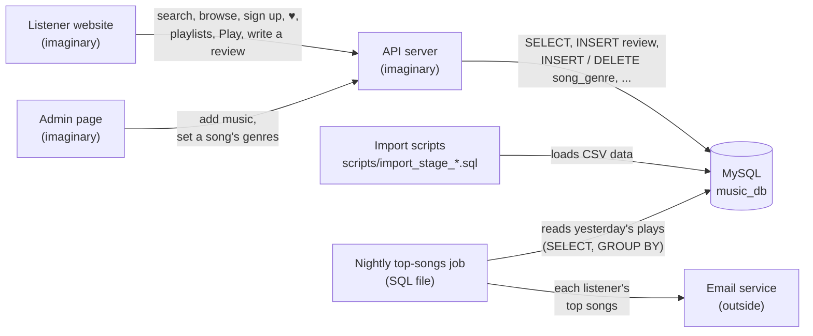

# Stage 4 (Week 10): more genres per song, and reviews

> **Status: built** (git tag `stage-4`).

**What changed and why:** pivot: one song can have more than one genre (Pop **and**
Dance), so `genre_id` moves out of `song` into a new junction table `song_genre`.
Listeners can also review albums with 1 to 5 stars, which the database checks with a
`CHECK` constraint.

**New in this stage:** the tables `song_genre` and `review`. `song.genre_id` is
**removed**. On the website, listeners can write reviews, and the admin page can give a
song several genres.

## Database (11 tables)



## The system around the database



New in this picture: the website's "write a review" and the admin page's "set a song's
genres" (new arrows, no new boxes).

## The pivot: one genre → many genres

**Before (Stages 1–3):** each song has exactly one genre, in the column `song.genre_id`.

| song_id | song_name | genre_id |
|---|---|---|
| 1742 | Golden Train | 1 (Rock) |

**The problem:** a real song can be Rock **and** Pop. One column holds only one value.

**Two wrong fixes:**

- `"Rock, Pop"` in one cell. That is a list in a cell, so it breaks **1NF**. We could
  not join it to `genre`, and a typo like `"Rokc"` would not be caught.
- Two columns, `genre_id_1` and `genre_id_2`. What about a third genre? And most songs
  would have an empty column.

**The right fix:** a junction table, one row for each song-and-genre pair.

| song_id | genre_id |
|---|---|
| 1742 | 1 (Rock) |
| 1742 | 2 (Pop) |

**The migration does it in 3 steps**, so no data is lost:

```sql
-- 1. Make the new table.
CREATE TABLE song_genre ( ... PRIMARY KEY (song_id, genre_id) ... );

-- 2. Move the data: every song keeps the genre it had.
INSERT INTO song_genre (song_id, genre_id)
SELECT song_id, genre_id FROM song;

-- 3. Remove the old column (first its foreign key, by name).
ALTER TABLE song DROP FOREIGN KEY fk_song_genre;
ALTER TABLE song DROP COLUMN genre_id;
```

## Why `review` is built like this

- **Two-column key** (`listener_id`, `album_id`): one listener writes **one** review for
  each album. To change it, they `UPDATE` it.
- **`CHECK (stars BETWEEN 1 AND 5)`:** the database refuses 0 or 6 stars.
- **`review_text` is optional:** a listener can give stars without writing anything.
- **2NF:** `stars`, `review_text` and `review_date` depend on the whole key (which
  listener **and** which album).
- **It connects listeners to albums:** for example, the average stars of each artist
  is a join `review` → `album` → `artist` with `GROUP BY` and `AVG`.

## Files in this stage

| File | What it does |
|---|---|
| `migrations/010_song_genre_pivot.sql` | creates `song_genre`, moves the data, removes `song.genre_id` |
| `migrations/011_create_review.sql` | creates `review` (two-column key, `CHECK` on `stars`) |
| `scripts/import_stage_4.sql` | adds a second genre to some songs, and loads the reviews |
| `data/song_genre_extra.csv`, `data/review.csv` | made-up practice data (180 extra genres, 90 reviews) |
| `queries/showcase.sql` | the review feature from start to end: `INSERT`, `JOIN` + `WHERE`, `GROUP BY`, `DELETE` (exam question 2, with `011_create_review.sql`) |
| `queries/test_constraints.sql` | 7 statements that **must fail**, one for each kind of constraint |
